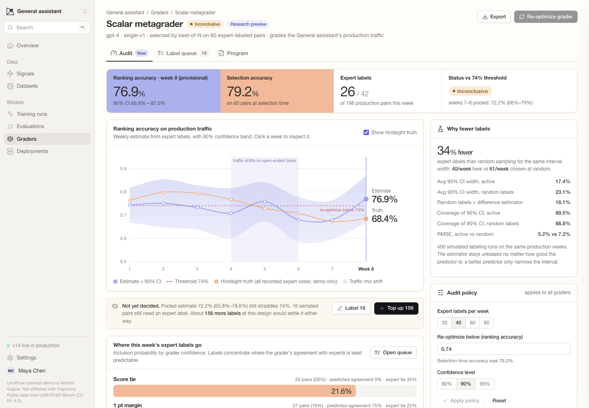

# Grader audit for Trajectory's Continual Grading

**Live demo:** https://mohith26.github.io/trajectory-grader-audit/

Trajectory's [Continual Grading](https://www.trajectory.ai/field-notes/continual-grading) learns a metagrader from about 60 expert labels and then grades production traffic with it. The post names the two open problems this leaves: production traffic drifts, "so a grader written once goes stale", and "choosing which rollouts experts label next" is still open (the [GS1 post](https://www.trajectory.ai/field-notes/you-only-rollout-once) says the same about deciding "which traces experts should review"). This is a concept feature for the Graders page that answers both with a small weekly expert budget: it picks which production pairs an expert should label, turns those labels into an unbiased estimate of the grader's **ranking accuracy** (the post's own metric) with a valid confidence interval, tells you how many more labels would settle whether the grader has fallen below your threshold, and offers a re-optimize action when it has. On real expert data it reaches the same interval width as random labeling with **34% fewer expert labels** (40 per week instead of 61).



Unofficial concept demo by Mohith Gajjela. Not affiliated with Trajectory. The app shell follows Trajectory's public product imagery and production CSS tokens.

## Data (real, public)

* **Expert labels:** LMSYS [MT-Bench human judgments](https://huggingface.co/datasets/lmsys/mt_bench_human_judgments) (CC BY 4.0): 3,355 pairwise votes from graduate-student experts on responses from 6 models to 80 questions in 8 categories.
* **Graders:** the two GPT-4 judges released with MT-Bench: the single-answer 1–10 grader (`gpt-4_single.jsonl`, a scalar grader like the one in the post's Figure 2) and the pairwise grader run in both orders (`gpt4_pair`).
* After joining (Vicuna-13B v1.2 has no public single-answer grade), **1,616 response pairs**, 1,274 with a non-tie expert majority. `scripts/extract_mtbench.py` builds `data/` from the raw files.
* **What is simulated:** only the arrival order. The pairs are dealt into a 60-pair selection set and 8 production weeks (~195 pairs each). Weeks 1–4 are mostly technical questions (STEM, coding, extraction, math); between weeks 4 and 6 the mix shifts to open-ended ones (writing, roleplay, reasoning, humanities). Because every pair has recorded expert votes, the true weekly ranking accuracy is known in hindsight, which is how the method is scored. The scalar grader genuinely drifts on this stream: 79.9% in week 2, 67.3% in week 7.

## How it works (`src/audit.js`)

Let `A_i = 1[expert prefers one response and the grader strictly agrees]` and `D_i = 1[expert is not tied]`. A week's ranking accuracy is `θ = ΣA / ΣD`. That is a finite-population ratio over that week's production pairs, with ties excluded as in the post.

1. **Predict.** From labels collected so far, a smoothed table predicts `P(D=1 | k)` and `P(agree | D=1, k)` for a feature `k` of the grader's own output: score margin for the scalar grader, verdict consistency for the pairwise one. A grader tie can never agree.
2. **Design.** Inclusion probabilities `π_i ∝ sqrt(Var(A_i − θ D_i | k_i))` (the Neyman-optimal rule for the linearized ratio, as in Zrnic & Candès, *Active Statistical Inference*, 2024), mixed 80/20 with uniform and capped at 1 by water-filling so they sum to the weekly budget. Pairs are drawn by Poisson sampling.
3. **Estimate.** Difference (model-assisted) estimator: `Â = Σ p̂A_i + Σ_sampled (A_i − p̂A_i)/π_i`, same for `D̂`, and `θ̂ = Â/D̂`. It is unbiased for both sums whatever the predictor's quality. The variance is the Horvitz–Thompson formula for Poisson sampling on the linearized residual, with a Student-t quantile.
4. **Decide.** Weeks t−1 and t are pooled and compared with the threshold using a one-sided 95% bound: *healthy*, *below* or *inconclusive*. When inconclusive, `labelsToDecide` says how many more labels would settle it. **Top up** draws them without breaking the design (each unsampled pair is drawn with probability `(π′−π)/(1−π)`, so its overall inclusion probability is exactly `π′`). **Re-optimize** queues a new metagrader search on every label collected.

## Results (400 simulated labeling runs on the fixed stream; `node scripts/build.mjs`)

| 40 expert labels / week | Scalar grader | Pairwise grader |
|---|---|---|
| Mean 90% CI width, this audit | **17.4 pts** | **19.3 pts** |
| Mean 90% CI width, random labels + sample ratio | 23.1 pts | 23.2 pts |
| Random labels needed for the same width | **60.5 / week (34% saving)** | 52.9 / week (24% saving) |
| Ablation: random labels + same difference estimator | 18.1 pts | 19.5 pts |
| Coverage of the 90% CI (audit / random) | 89.5% / 88.8% | 88.5% / 88.5% |
| RMSE (audit / random) | 5.2 / 7.2 pts | 5.9 / 7.2 pts |
| Week 8 flagged "below 74%" (truth 68.4% for scalar) | 43.5% of runs (random labels: 29.5%) | 4.3% of runs (truth 73.0%) |

The app shows one typical run (seed 24: its error is within 0.006 of the median for both graders, and it was the first such seed whose intervals covered the truth every week). Its week 8 starts partly labeled so the queue, top-up and re-optimize flow can be tried.

## Honest limitations

* **Most of the gain comes from the estimator, not the sampling design.** The ablation row shows random sampling plus the same difference estimator gets 18.1 pts against 17.4. The grader's own margin is a strong control variate. Choosing which pairs to label adds a little on top of that. A richer predictor (judge log-probs, disagreement between best-of-N candidates) should widen the design's share. I tried a committee feature from the other grader and it did not help here.
* **Drift detection is weak at 40 labels a week.** A 74% threshold against a true 68% is flagged in week 8 in 43.5% of runs. The app says "inconclusive", reports how many labels would settle it, and lets you top up. It does not claim a detection it cannot make. The pooled weekly test is not anytime-valid. `alphaSpend` (union-bound spending) is in the core for that, but at this budget it is too conservative to be useful.
* **The provisional estimate assumes random labeling order.** The queue is shuffled, so a partly finished queue is a random subsample of the design. Cherry-picking pairs breaks this.
* **Not Trajectory's data or graders.** MT-Bench is a general chat benchmark with GPT-4 judges, not Harvey-LAB or τ³-Bench with metagraders. The traffic shift is simulated. The selection accuracy (79.2% on 60 pairs) is itself noisy, a winner's-curse effect of best-of-N selection that this audit makes visible but does not correct.
* **Ranking accuracy treats a grader tie as a miss** (strict inequality, as written in the post). Ties are common for a 1–10 scalar grader (28% of pairs).

## Prior art and what is new

Design-based and prediction-powered estimation with ML proxies is established: model-assisted survey estimation (Särndal, Swensson & Wretman), prediction-powered inference (Angelopoulos et al., 2023), active statistical inference (Zrnic & Candès, 2024), and LLM-judge evaluation with few human labels (Boyeau et al., *AutoEval Done Right*, 2024; Chatzi et al., 2024). What I could not find, in Trajectory's docs, field notes and changelog or in eval platforms I checked, is this pieced together as a **standing grader audit for an RL reward**. It runs continuously on production traffic, uses the post's own ranking-accuracy target (a ratio estimand with expert ties excluded), tops up within the design, reports how many labels are needed to decide, and hands off to re-optimization. The post lists label choice and staleness as open; this is one concrete, measured answer.

## Run it

```
python3 -m http.server   # then open http://localhost:8000
node --test test/*.test.mjs   # 14 tests, ~4 s
node scripts/build.mjs       # regenerates data/results.json (deterministic)
```

No build step and no dependencies: static HTML/CSS/JS, Lucide icons from a CDN, Geist Mono from Google Fonts. Shortcuts: `⌘K` search; in a pair, `1`/`2`/`3` label A/B/tie, `J`/`K` next/previous, `Esc` close. State (labels, top-ups, policy) persists in localStorage, and every view has a deep link (e.g. `#/graders/scalar/queue?filter=pending`).
